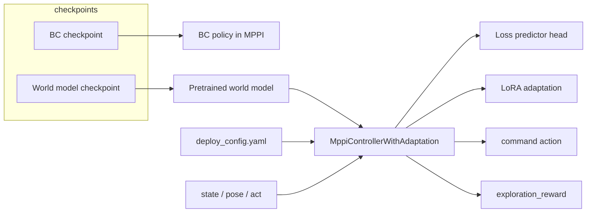

# Example: deploy world model + adaptation + loss prediction

This example shows how to load **trained checkpoints** and run the same control
stack exercised in `tests/test_control.py::test_mppi_controller_adaptation_with_loss_pred`:
`load_model_from_ckpt` for the BC policy and world model, then
`MppiControllerWithAdaptation` with settings in `config/deploy_config.yaml`.

## What you need

- Conda env with this package installed (`pip install -e .[training]` and JAX).
- The **dummy** checkpoints in `checkpoints/` (committed in git) **or** your own
  trained BC + world-model directories from `scripts/train.py`.

> **Important:** The committed checkpoints are only 2 training steps on random
> dummy data. They demonstrate file layout and APIs only — not competent control.

## Quick start

From the repository root:

```bash
conda activate terra
python examples/deploy_mppi_adaptation_loss_pred/deploy_mppi_adaptation_loss_pred.py
```

First run compiles JAX functions and fills history buffers; expect up to ~1–2 minutes
on CPU before steps print.

### Use your own checkpoints

```bash
python examples/deploy_mppi_adaptation_loss_pred/deploy_mppi_adaptation_loss_pred.py \
  --bc-checkpoint /path/to/your/bc_run \
  --world-model-checkpoint /path/to/your/world_model_run
```

Checkpoint directories must be Orbax saves from this repo’s trainer (contain
`config.yaml` and numbered step subdirectories).

## Architecture (offline loop)



Each control cycle:

1. **`update(state, pose, act)`** — append latest measurements to rolling buffers.
2. **`run_control(planner_poses)`** — MPPI rollouts using the BC prior and world model;
   with loss prediction enabled, rollouts include an **exploration bonus** derived from
   predicted adaptation difficulty (`exploration_reward` in outputs).
3. **`adapt()`** — sample sequences from the adaptation buffer and apply a gradient
   step on LoRA weights (and the loss predictor) using the loss defined in the
   deploy config.

## Saving and loading adaptation

Online adaptation is separate from the pretrained BC / world-model checkpoints.
After LoRA and the loss predictor have been updated, you can persist the running
state with `MppiControllerWithAdaptation.save_adaptation` and restore it later
with `load_adaptation`.

| What | On disk (when `path` is set) |
|------|------------------------------|
| LoRA + loss-predictor parameters | `<path>/adapt_params/` (Orbax PyTree) |
| Adaptation history buffer | `<path>/*.npy` (obs, pose, act, path_line_def, episode_starts) |

Typical usage:

```python
# After one or more adapt() calls — e.g. end of mission, before power-off
controller.save_adaptation("/data/run_123/adaptation")

# On the next session, after initialize() and before the control loop
controller.load_adaptation("/data/run_123/adaptation")
```

Pass `path=None` to snapshot state in memory only (`save_adaptation()` then
`load_adaptation()`), without writing files.

The example script runs this save/load demo at the end (default directory
`.adaptation_state/` under the example folder). Disable it with
`--no-adaptation-save-demo`, or set `--adaptation-save-dir` for a custom path.

## Configuration

`config/deploy_config.yaml` has three sections passed to the controller:

**MPPI** (`mppi_cfg`), **reward** (`ErnestRewardFunction`), and **adaptation**
(including `loss_pred`).

| File | Role |
|------|------|
| `config/deploy_config.yaml` | `mppi`, `reward_fn`, and `adaptation` (including **loss_pred**) |
| `checkpoints/behavior_cloning/` | Policy used as MPPI prior |
| `checkpoints/world_model/` | Pretrained dynamics model (loss predictor is added at runtime) |

Override the default deploy settings with `--deploy-config /path/to/deploy_config.yaml`.

The world-model checkpoint does **not** include loss-prediction weights. When
`loss_pred.use_loss_pred` is true, `MppiControllerWithAdaptation` wraps the loaded
model with `WorldModelWithLossPredTransformer` and trains that head online (see
`terra/control/mppi_controller.py`).

## Regenerating dummy checkpoints

Maintainers can refresh the committed dummy weights:

```bash
python scripts/generate_example_deploy_checkpoints.py
```

See `checkpoints/README.md` for details on checkpoint contents.

Replace the synthetic `state` / `pose` / `act` vectors in the script with measurements
from your environment when integrating this loop elsewhere.
